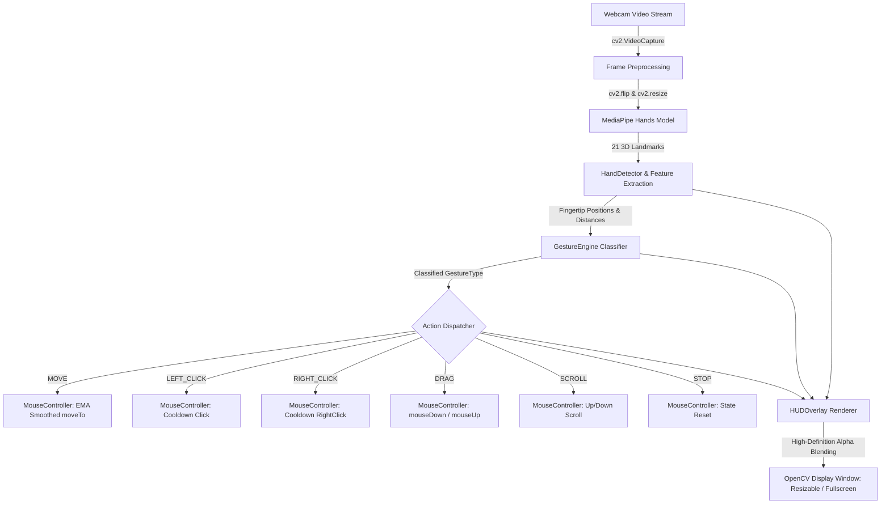

# 🖐️ Finger-Controlled Mouse (Air Mouse)

[](https://www.python.org/)
[](https://opencv.org/)
[](https://developers.google.com/mediapipe)
[](https://pyautogui.readthedocs.io/)

An intelligent, vision-based touchless mouse control system that transforms your webcam into an intuitive air mouse. By leveraging **MediaPipe Hands** for real-time 21-point 3D hand tracking, **OpenCV** for computer vision & video processing, and **PyAutoGUI** for OS-level input automation, this system enables effortless cursor movement, clicks, dragging, and scrolling—without touching physical hardware.

---

## 🌟 Key Highlights & Features

- 🖥️ **Full-Screen Applicable & Resizable Display**:
  - Dynamically toggle between normal windowed mode and **immersive full-screen view** with a single hotkey (`F`) or CLI argument (`--fullscreen`).
  - Automatically adapts display resolution with crystal-clear, anti-aliased HUD rendering.
- 🎯 **Precision Cursor Tracking & Smoothing**:
  - Employs **Exponential Moving Average (EMA)** filtering to eliminate micro-jitters, ensuring buttery-smooth and accurate cursor movement.
- 📐 **Active Cursor Interaction Zone**:
  - Maps an internal boundary box to your entire monitor resolution (`np.interp`), enabling your pointer to reach all 4 screen corners without straining your arm.
- 🤏 **Rich Gesture Recognition Engine**:
  - Supports Point/Move, Left Click, Right Click, Drag & Drop, Two-Way Scroll, and Emergency Stop.
- 📊 **Modern Head-Up Display (HUD)**:
  - Translucent glassmorphism badges displaying real-time gesture status, live FPS counter, fingertip distance metrics, and hotkey guides.
- ⚡ **Interactive Runtime Tuning**:
  - Adjust pinch sensitivity and thresholds on the fly using keyboard shortcuts (`+` / `-`).
- 🛡️ **Safety & Debounce Management**:
  - Built-in click cooldowns and fist-based emergency brake to prevent accidental double-clicks or runaway drags.

---

## 🖐️ Gesture Reference Guide

| Gesture | Action | Hand Posture | Description |
| :---: | :---: | :--- | :--- |
| 👆 | **Move Cursor** | **Index finger alone extended** | Point with your index finger. The cursor follows fluidly within the active zone. |
| 🤏 | **Left Click** | **Thumb + Index finger pinch** | Pinch your thumb and index fingertips together (`dist < threshold`). Moves & clicks. |
| ✌️➕👍 | **Right Click** | **Thumb + Index + Middle close** | Bring your thumb, index, and middle fingertips close together to right-click. |
| ✌️ | **Drag & Drop** | **Index + Middle held together** | Bring index and middle fingers together (`dist < threshold`) to engage mouse hold (`mouseDown`). Move to drag; separate fingers to drop (`mouseUp`). |
| 🖖 | **Scroll Mode** | **Index + Middle + Ring extended** | Raise index, middle, and ring fingers together. Moving hand **up** scrolls up; moving hand **down** scrolls down. |
| ✊ | **Emergency Stop** | **Fist (all fingers curled)** | Clench your hand into a fist to immediately release all mouse holds and cancel operations. |

---

## ⌨️ Interactive Keyboard Controls

While the camera display window is focused, you can use the following keyboard shortcuts:

| Key | Function | Description |
| :---: | :--- | :--- |
| <kbd>F</kbd> | **Toggle Fullscreen** | Switches instantly between standard resizable window and true full-screen mode. |
| <kbd>H</kbd> | **Toggle HUD** | Hides or shows the Head-Up Display cards and diagnostics overlay. |
| <kbd>+</kbd> / <kbd>=</kbd> | **Increase Threshold** | Increases pinch distance threshold (+5px) for easier click triggering. |
| <kbd>-</kbd> / <kbd>_</kbd> | **Decrease Threshold** | Decreases pinch distance threshold (-5px) for tighter, more intentional clicks. |
| <kbd>Q</kbd> / <kbd>ESC</kbd> | **Quit Application** | Safely releases camera hardware, resets mouse states, and closes windows. |

---

## 🏗️ System Architecture



### Module Structure

```
Finger-Controlled-Mouse/
├── .gitignore                  # Git exclusions (venv, caches, IDE configs)
├── README.md                   # Complete documentation & user manual
├── requirements.txt            # Python dependencies
└── finger_controlled_mouse.py  # Structured master script containing:
    ├── MouseConfig             # Dataclass with all customizable parameters
    ├── GestureType             # Enum of recognized gesture actions
    ├── HandLandmarkIndex       # Named constants for MediaPipe 21 landmarks
    ├── HandDetector            # MediaPipe hands wrapper & distance calculator
    ├── MouseController         # PyAutoGUI interface with EMA cursor smoothing
    ├── HUDOverlay              # Translucent UI elements, cards & visual feedback
    └── FingerMouseApp          # Application coordinator & event loop
```

---

## 🚀 Getting Started

### Prerequisites

- **Python**: Version **3.10** or **3.11** (recommended for best MediaPipe binary compatibility).
- **Webcam**: Standard built-in or external USB camera.
- **Operating System**: Linux (X11 / Wayland), macOS, or Windows 10/11.

---

### Installation

1. **Clone the repository**:
   ```bash
   git clone https://github.com/darkwing-09/Finger-controlled-mouse.git
   cd Finger-controlled-mouse
   ```

2. **Create and activate a virtual environment**:
   - **Linux / macOS**:
     ```bash
     python3.11 -m venv .venv
     source .venv/bin/activate
     ```
   - **Windows**:
     ```powershell
     python -m venv .venv
     .venv\Scripts\activate
     ```

3. **Install dependencies**:
   ```bash
   pip install --upgrade pip
   pip install -r requirements.txt
   ```

---

## 🎮 How to Run

### Basic Execution
Launch with default settings (1280x720 window, 5.0 smoothing factor):
```bash
python finger_controlled_mouse.py
```

### Full-Screen Mode
Start directly in immersive full-screen display:
```bash
python finger_controlled_mouse.py --fullscreen
```

### Custom Configuration Flags
You can fine-tune every aspect via CLI flags:
```bash
python finger_controlled_mouse.py \
  --camera 0 \
  --fullscreen \
  --smooth 6.0 \
  --threshold 60.0 \
  --cooldown 0.20
```

### Command-Line Arguments Reference

| Option | Type | Default | Description |
| :--- | :---: | :---: | :--- |
| `--camera` | `int` | `0` | Device index for the webcam (`0` for primary). |
| `--fullscreen` | `flag` | `False` | Launch immediately in full-screen mode. |
| `--width` | `int` | `1280` | Rendered display window width in pixels. |
| `--height` | `int` | `720` | Rendered display window height in pixels. |
| `--smooth` | `float` | `5.0` | Cursor smoothing divisor (higher = smoother, lower = faster). |
| `--threshold` | `float` | `55.0` | Pinch detection distance threshold in pixels. |
| `--cooldown` | `float` | `0.18` | Minimum interval (in seconds) between clicks. |
| `--no-hud` | `flag` | `False` | Hide Head-Up Display elements on launch. |

---

## ⚙️ Configuration & Fine-Tuning

All settings can be customized in code inside `MouseConfig` or passed via command line:

```python
@dataclass
class MouseConfig:
    camera_id: int = 0
    display_width: int = 1280          # Upscaled display canvas width
    display_height: int = 720          # Upscaled display canvas height
    fullscreen: bool = False           # Fullscreen display mode
    smoothening: float = 5.0           # Cursor EMA smoothing factor
    click_threshold: float = 55.0      # Finger pinch distance in pixels
    click_cooldown: float = 0.18       # Seconds between consecutive clicks
    scroll_threshold: float = 16.0     # Hand vertical delta for scroll
    margin_x: int = 90                 # Horizontal boundary deadzone
    margin_y: int = 70                 # Vertical boundary deadzone
    min_detection_confidence: float = 0.70
    min_tracking_confidence: float = 0.60
```

---

## 💡 Pro-Tips for Optimal Tracking

1. **Lighting**: Ensure even, frontal lighting on your hand without strong backlighting or shadows.
2. **Camera Placement**: Place your webcam at chest or eye level, roughly 0.5m – 1.5m away.
3. **Screen Corners**: Use the **Active Cursor Zone** box as your reference; moving your fingertip to the edges of this box easily reaches the physical edges of your monitor.
4. **Click Stability**: While pinching thumb and index finger, hold your hand steady for a split second to click precisely without shifting the pointer.

---

## 🛠️ Troubleshooting

<details>
<summary><b>1. OpenCV window is too small or hard to see from a distance</b></summary>

- Simply press <kbd>F</kbd> while the window is focused to enter **Full-Screen Mode**.
- Or launch the script with the `--fullscreen` flag:
  ```bash
  python finger_controlled_mouse.py --fullscreen
  ```
</details>

<details>
<summary><b>2. Mouse movement feels jittery or too slow</b></summary>

- If jittery: Increase smoothing with `--smooth 7.0` or higher.
- If too sluggish: Lower smoothing with `--smooth 3.0` for rapid, direct response.
</details>

<details>
<summary><b>3. Linux (Ubuntu / Debian / Fedora) PyAutoGUI or Camera permissions</b></summary>

- **X11 vs Wayland**: PyAutoGUI natively supports X11. If using Wayland and mouse actions are blocked, switch your desktop session to X11 on your login screen.
- **Camera Access**: Ensure your user is in the `video` group:
  ```bash
  sudo usermod -aG video $USER
  ```
</details>

<details>
<summary><b>4. macOS Camera & Accessibility Permissions</b></summary>

- In macOS **System Settings** > **Privacy & Security**:
  - Grant **Camera** permission to your terminal / Python.
  - Grant **Accessibility** permission to enable simulated cursor clicks and movement.
</details>

<details>
<summary><b>5. MediaPipe compatibility error on Python 3.13</b></summary>

- MediaPipe 1.x `mp.solutions.hands` is optimized for Python 3.10 and 3.11. Use the provided Python 3.11 virtual environment as instructed in the installation guide.
</details>

---

<p align="center">
  <b>Developed by <a href="https://github.com/darkwing-09">darkwing-09</a></b>
</p>
